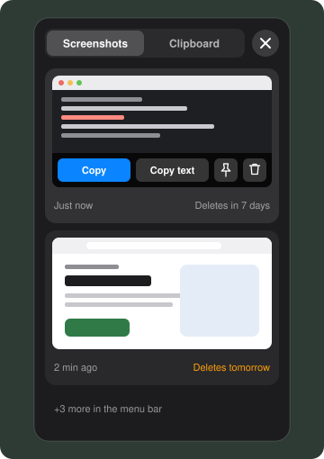
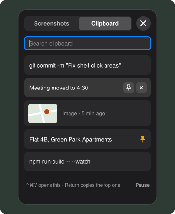
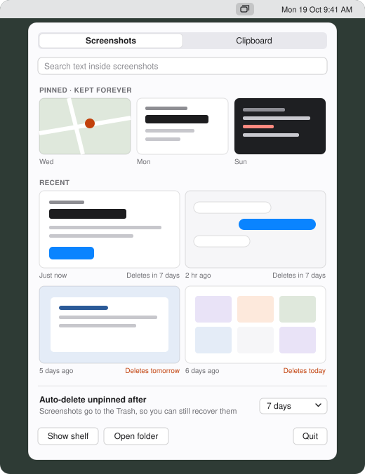
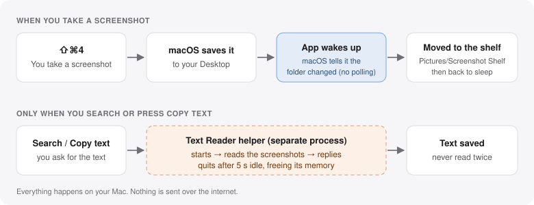

# Screenshot Shelf

A small menu bar app for macOS 13+. New screenshots land on a floating shelf
instead of piling up on your Desktop, and everything you copy is kept in a
searchable clipboard history.

  

  
  &nbsp;&nbsp;
  

Animation and illustrations drawn from the app's layout; the real thing looks the same but with your own screenshots. The tour is generated by `docs/tour/make_tour.py` (render frames) and `docs/tour/encode_gif.py` (build the GIF).

## Build and run

    git clone https://github.com/arpitansu/ScreenshotShelf.git
    cd ScreenshotShelf
    ./build.sh
    open "build/Screenshot Shelf.app"

Needs macOS 13 or later and Xcode or the Command Line Tools (`xcode-select --install`).
If `./build.sh` says "permission denied", run `chmod +x build.sh` once, or use `bash build.sh`.

The first time, macOS asks to let the app access your Desktop. Click **Allow**:
that's how it picks up new screenshots.

> **Early version.** It's been used on one Mac so far. If something doesn't work on
> yours, please open an issue with your macOS version and what happened.

## The shelf

Take a screenshot (⇧⌘3 / ⇧⌘4 / ⇧⌘5). It moves to `~/Pictures/Screenshot Shelf`
and appears on the shelf at the top-right of your screen.

- **Hover a card** for **Copy** (the image), **Copy text**, **Pin** and **Move to Trash**.
- **Drag a card** straight into any app: chat, email, a document.
- **Double-click** to open it in Preview.
- Each card shows when it will be auto-deleted. **Pinned** screenshots are kept forever.
- Close the shelf with **✕** or **Esc**.

## Clipboard history

(Second picture at the top.) Everything you copy, text and images, is saved.

- Press **⌃⌘V** anywhere to open it.
- Type to search. Click an entry, or press **Return** for the top one, to copy it
  again, then **⌘V** to paste.
- Hover an entry to **pin** or **remove** it.
- Copies from password managers are skipped automatically.
- **Copies from your iPhone or iPad** (Universal Clipboard) are saved too: text with a
  small phone icon, images labelled "Image from iPhone". Images are fetched from the
  phone in the background, so the app never freezes; a large photo may briefly show
  macOS's own "Pasting from iPhone" progress. Turn off **Also save images copied on
  iPhone or iPad** (menu bar → Clipboard) if you'd rather not have every phone image
  transferred. Needs Handoff on and both devices on the same Apple Account, as for
  normal Universal Clipboard.
- **Pause** (bottom right) stops recording until you press **Resume**, even across
  restarts. Use it while copying anything sensitive.

## Menu bar library

  

Click the menu bar icon to see everything:

- **Search the text inside your screenshots**, e.g. "invoice" or an error message.
- **Pinned** screenshots at the top, then **Recent** ones with their auto-delete date
  (orange = deleting soon).
- **Auto-delete** unpinned items after 1, 3, 7 (default), 14 or 30 days.
- The **Clipboard** tab shows your full history, with **Pause history** and **Clear unpinned**.

## How it works

  

- **No polling for screenshots.** macOS wakes the app only when the screenshot
  folder changes.
- **Text is read only when you need it**, when you press Copy text or search.
  Each screenshot is read once and the result is saved.
- **Text reading runs in a separate helper** (an XPC service inside the app,
  shown as "Screenshot Shelf Text Reader"). It starts on demand and quits about
  5 seconds after its last job, handing all its memory back to the system.
  The main app never loads Apple's text-recognition engine.
- The shelf's views and thumbnails are freed whenever it's hidden.
- The clipboard is checked twice a second (macOS has no "copied" notification);
  each check reads a single number.
- "AutoFill (Screenshot Shelf)" in Activity Monitor is a macOS system helper that
  appears for any app's text box. It isn't part of this app.

## Privacy and safety

- **Nothing leaves your Mac.** No network access at all; text recognition is on-device.
- **No system changes.** No admin rights, no settings changed, nothing installed to run at login.
- **Screenshots are only ever moved to the Trash**, never deleted outright.
  Screenshots taken while the app was closed are picked up the next time it starts;
  older ones already on your Desktop (and everything on the very first launch) are left alone.
- **Clipboard history is stored as a plain file** in
  `~/Library/Application Support/ScreenshotShelf/`. It keeps at most 200 entries
  and 30 images (10 MB max each), and follows the auto-delete setting.
- **Lowering the auto-delete setting applies right away**: older unpinned
  screenshots go to the Trash immediately.

## Start at login (optional)

Copy the app to /Applications, then System Settings → General → Login Items → +.

## License

MIT. See [LICENSE](LICENSE).
